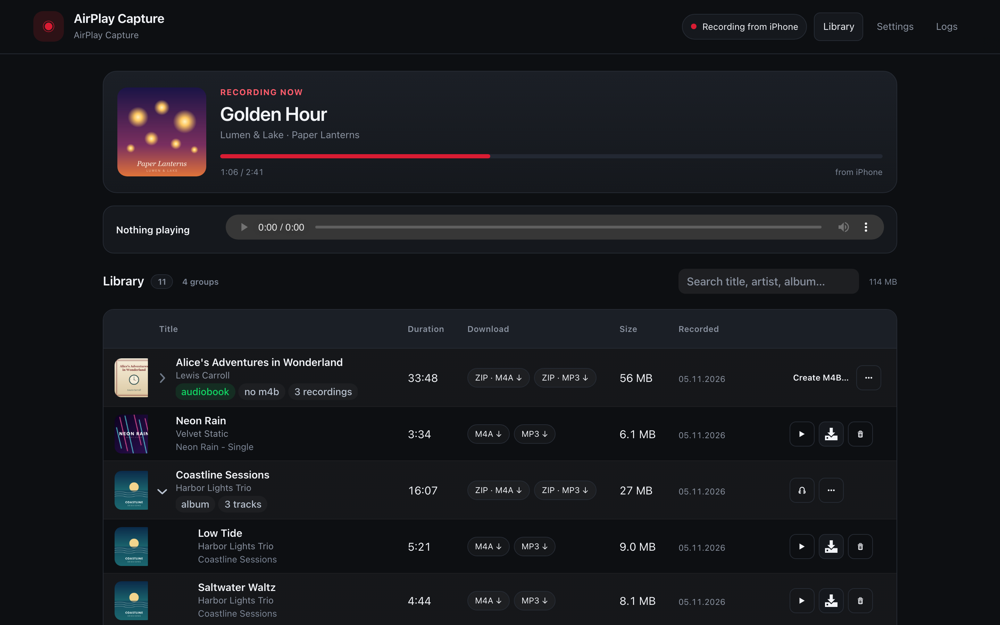
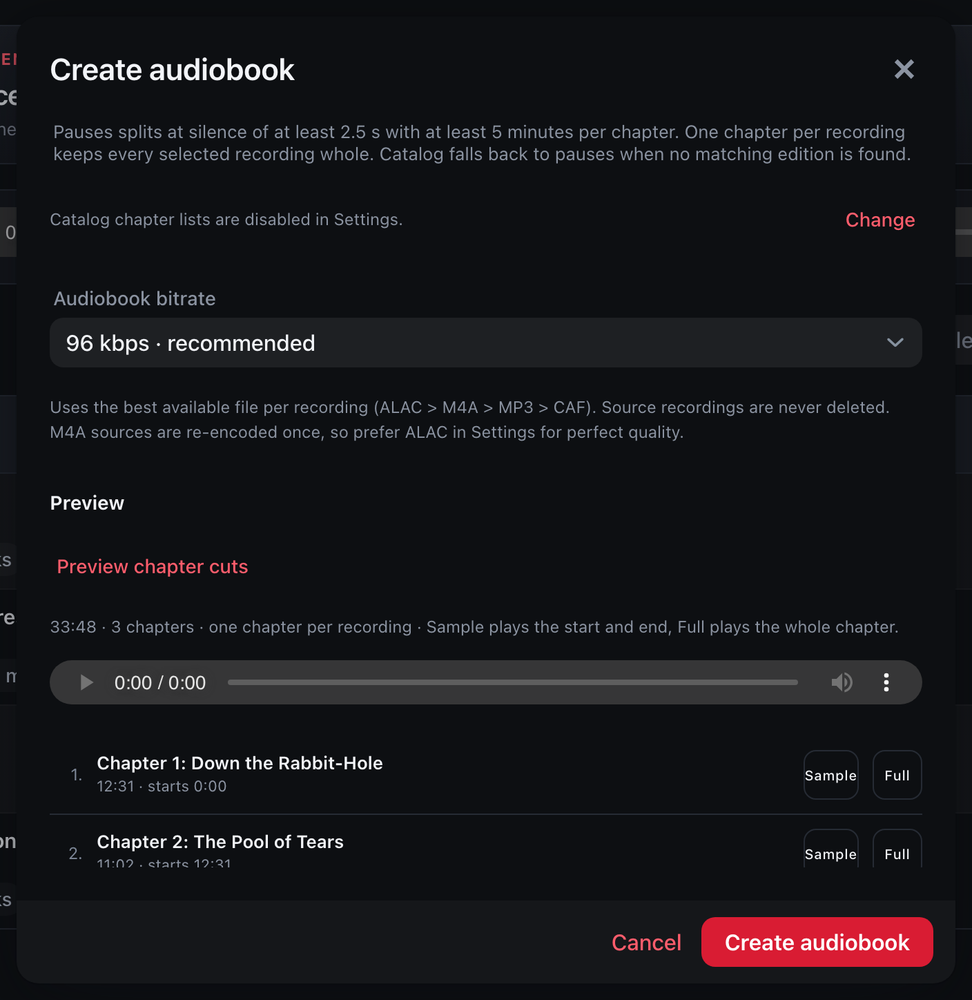
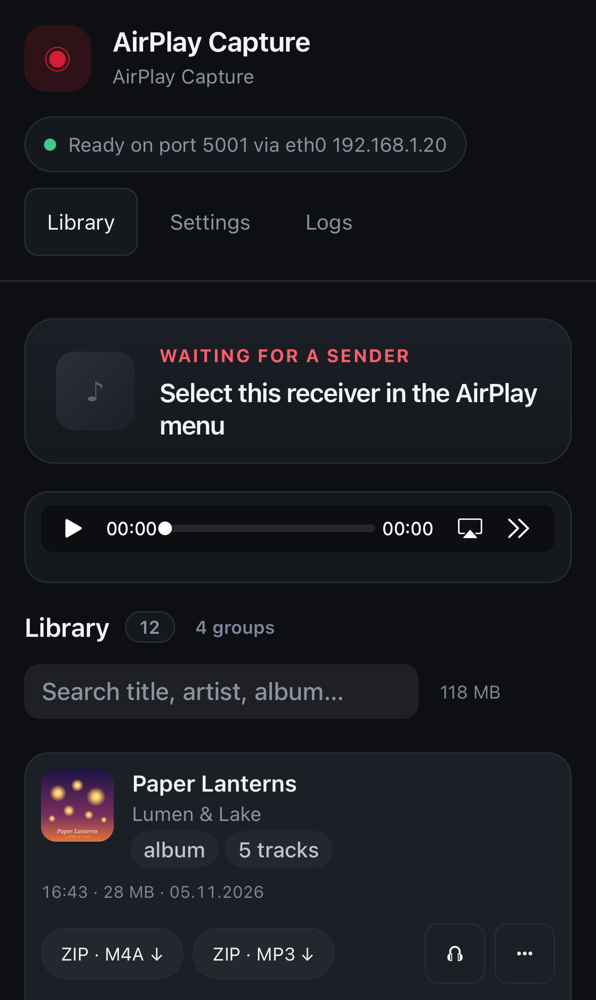

<div align="center">
  

  # AirPlay Capture

  **Record AirPlay audio as individual files with cover art and metadata.**

  Runs on macOS and Linux, in Docker — and as a **Synology package (.spk)** for your NAS.

  [Synology SPK](#synology-nas-spk) · [Docker](#docker) · [macOS / Linux](#macos--linux) · [Using it](#using-it) · [License](#license)
</div>



## What it does

Start playback on your iPhone, iPad or Mac and pick **AirPlay Capture** in the AirPlay menu.
Every song lands in your library as `Artist - Title.m4a` (and optionally `.mp3` or lossless
`.alac`), with cover art, title, artist, album, genre and track number — ready for MP3 players,
Toniebox, Audiobookshelf and friends.

- **One file per track**, split automatically from AirPlay metadata, with a silence/timeout fallback.
- **Lossless capture**: the original ALAC frames are kept; ffmpeg exports AAC, MP3 or ALAC.
- **Audiobooks**: detected chapters can be turned into a single chaptered **`.m4b`**, with a preview
  of every cut before you create it.
- **A library that stays usable**: albums and books are one expandable row, groups download as ZIP,
  and re-recorded songs stay visible as separate takes with the best one marked.
- **Cover art and tags completed** from Apple's catalog (Deezer/MusicBrainz as fallback) when the
  sender leaves them out — sender values always win, and this can be turned off.
- **Resilient**: lost packets are requested again, and unrecoverable gaps are marked on the track
  instead of silently shortening it.
- **Works on your phone**: the same web UI adapts to small screens; on Synology it can be added to
  your Home Screen like an app.

## Installation

### Synology NAS (SPK)

**A ready-to-install Synology package is available** for **DSM 7.2.1+ with Container Manager**
(**x86_64**). The package contains its Docker images, so the NAS needs no registry access and no
extra port or firewall rule — the UI is served through DSM's own HTTPS port.

1. Download `airplay-capture-<version>-x86_64.spk` from the
   [Releases page](https://github.com/moritzfl/airplay-capture/releases).
2. In **Package Center → Manual Install**, choose the SPK and install it.
3. Open the **AirPlay Capture** desktop icon and sign in with your DSM account.

Recordings go to **`/volume1/music/airplay-capture`** by default (the default music share); settings
and covers stay in the **`airplay-capture`** shared folder. In the window, **Manage** lets you move
the recordings folder and enable **Open on phones…** (DSM Login Portal), which gives the app its own
address such as `https://<nas>:5001/airplay-capture/`.

Other users need access in **Control Panel → Application Privileges**. Uninstalling keeps the shared
folder and your recordings.

### Docker

Requires Docker with Compose. The web UI is published on **port 8080**:

```bash
docker compose up -d --build
# open http://localhost:8080/app/
```

To actually **receive AirPlay**, the container needs **host networking** (mDNS discovery and the
RTP/UDP audio path). Use the host variant on Linux:

```bash
docker compose -f docker-compose.host.yml up -d --build
```

On Docker Desktop for macOS, host networking is an opt-in beta and mDNS is unreliable — run the app
natively there instead and use Docker for browsing the library. Files are written to `./data`.

### macOS / Linux

Requires **JDK 21** and **ffmpeg** (`brew install ffmpeg` / `apt install ffmpeg`):

```bash
./gradlew bootRun
# open http://localhost:8080/app/
```

Or build a runnable jar:

```bash
./gradlew bootJar
java -jar build/libs/airplay-capture-1.0.0.jar --data ~/airplay-data
```

On macOS 15+, allow the terminal (or IDE) under **System Settings → Privacy & Security → Local
Network**, otherwise the receiver never appears in the AirPlay menu.

## Using it

### Record

Play anything in an app that supports AirPlay (Music, Spotify, Audible, Apple Books, …) and choose
**AirPlay Capture** as the output. The header shows the track being recorded with its cover and
progress. Tracks shorter than 3 seconds are discarded.

### Play and download

The library groups recordings by album (or book). Expand a group to play a track or download exactly
the format you want; `ZIP · M4A` / `ZIP · MP3` downloads the whole group, and a finished audiobook
offers `M4B` directly. Recording the same song again never merges files: the **best take** is marked
and used for ZIPs and audiobooks, the others stay available.

### Turn chapters into an audiobook

Open a book group and choose **Create M4B…**:

1. Pick the source recordings (best takes are preselected).
2. Check title and author, or look up an edition in Apple Books / Deezer / MusicBrainz.
3. Choose chapters **from the catalog**, **at pauses**, or **one per recording**.
4. **Preview chapter cuts** to see and hear every boundary before committing.
5. Create the `.m4b` — it keeps chapters and cover, and the source recordings are never deleted.



Conversions run in the background with live progress in the **Audiobook conversions** card, so you
can keep recording. Finished jobs offer **Download M4B** and **Show in library**; failed jobs keep
their reason visible.

### Use it on your phone

The web UI works on small screens, so you can browse, play and download from your phone.



On Synology, open **Manage → Open on phones…** once, then open the address on your phone and use
**Share → Add to Home Screen** for an app-like icon.

### Settings

Receiver name, interface address, output formats and bitrates, silence timeout, ffmpeg path,
lost-packet recovery, metadata completion and audiobook behaviour are editable in **Settings** and
stored in `settings.json` in the data directory. Standalone options:

| Option | Environment | Default |
| --- | --- | --- |
| `--data <dir>` | `AIRPLAY_CAPTURE_DATA` | macOS: `~/Library/Application Support/AirPlayCapture`, Linux: `~/.airplay-capture` |
| `--web-port <port>` | `AIRPLAY_CAPTURE_WEB_PORT` | `8080` |
| – | `AIRPLAY_CAPTURE_WEB_USER` | `recorder` (only used with a password) |
| – | `AIRPLAY_CAPTURE_WEB_PASSWORD` | unset – web UI/API have no authentication |
| – | `AIRPLAY_CAPTURE_LIBRARY_DIR` | `library` inside the data directory |

**Set a password** if the web port is reachable by others, and keep it on a trusted network. On
Synology, DSM handles sign-in and per-user privileges for you.

### Where files go

| Installation | Recordings | Settings / covers |
| --- | --- | --- |
| Synology SPK | `/volume1/music/airplay-capture` (adjustable) | `airplay-capture` shared folder |
| Docker | `./data/library` | `./data` |
| macOS / Linux | `<data>/library` | `~/Library/Application Support/AirPlayCapture` or `~/.airplay-capture` |

## Troubleshooting

**The receiver does not appear in the AirPlay menu.**
Keep the sender and the receiver on the same subnet (mDNS does not cross VLANs without a repeater).
On macOS, grant **Local Network** permission. On a NAS, the log's `listening on <ip> via <interface>`
line must show the LAN address, not a Docker/VPN one; set **Settings → Interface address** if needed.
With a firewall enabled, allow **IGMP and UDP 5353** for discovery, plus the RTSP port (5002 by
default) and the UDP audio ports.

**A track has gaps or is marked incomplete.**
AirPlay is a real-time stream: the sender decides how long it keeps packets for retransmission. The
receiver reorders packets and requests missing ones for up to 2.5 s by default; unrecoverable holes
are shown as `audio gaps` with the packet count, and a track stopped early is marked `incomplete`.

**No M4A/MP3 was produced.**
Install ffmpeg, or check **Settings → ffmpeg path**. Without it the lossless `.caf` capture is kept
and the track is marked, so nothing is lost.

**Limits.**
Classic **AirPlay 1 (RAOP)** only — AirPlay 2 features (multi-room, HomePod grouping) are not
implemented, and **one sender at a time** can stream. Record only content you are allowed to record.

---

## Technical details

### Stack

| Layer | Technology |
| --- | --- |
| Runtime | Java 21, Spring Boot 4.1 |
| UI | Vaadin 25 (server-side, dark Lumo theme), server push |
| Receiver | plain Java: RTSP/RTP, RSA-OAEP + AES-128-CBC, mDNS via JmDNS |
| Capture | lossless ALAC frames muxed into CAF, no native code |
| Export | ffmpeg (AAC, MP3, ALAC) with tags and cover art |

The receiver/recording core has no Spring or Vaadin dependency; the web layer is a thin shell.

### How recording works

1. The receiver advertises `_raop._tcp` and accepts the RTSP handshake (ANNOUNCE/SETUP/RECORD).
2. Audio arrives as AES-128-CBC encrypted RTP packets, one ALAC frame per packet. Packets are
   reordered and missing ones are requested again from the sender.
3. DMAP metadata (`minm`, `asar`, `asal`, `asgn`, …), artwork and progress arrive over RTSP and are
   attached to the running track. A metadata change, FLUSH, disconnect or configurable silence
   (default 6 s) closes the track.
4. The ALAC frames are stored in a CAF container (lossless, no native code) and ffmpeg exports the
   configured formats with tags and cover art.

### Formats

| Setting | Output | Notes |
| --- | --- | --- |
| `m4a` | AAC in MP4 | default 192 kbps, plays everywhere Apple does |
| `mp3` | MP3 (LAME VBR or CBR) | VBR quality V0–V9 or a fixed bitrate |
| `alac` | ALAC in MP4 | lossless copy of the received stream |
| `m4b` | AAC audiobook | generated per book, contains chapters and cover |

ZIPs are streamed on demand and contain the best take per duplicate title (`?all=1` includes every
take). Downloads use `Content-Disposition: attachment` with the real filename, so Safari keeps
`.m4b`/`.mp3` instead of deriving an extension from the MIME type.

### Duplicate takes

Re-recording the same track (same title and artist inside one group) never merges files. The best
take is ranked complete before incomplete, then fewer lost packets, then longer, then newer. ZIP
downloads and audiobook assembly use it by default; other takes remain playable and downloadable.

### Dropouts and retransmits

Packets are reordered in a 4096-packet buffer, missing sequence numbers are requested on the control
channel every 150 ms covering every outstanding 64-packet range, and a gap is only accepted after
**Lost-packet recovery** (default 2.5 s) without a retransmit. A longer window recovers more packets
but delays when the damaged region is written; once accepted, late retransmits are ignored and the
hole is filled with silence to keep the timeline intact.

### Metadata completion

AirPlay metadata is not guaranteed: Apple Music usually sends title, artist and album, but genre,
year, track number and artwork are often missing. With **Fill missing tags from Apple catalog**
enabled, the exporter fills only empty fields, with a strict title/artist match, using Apple first
and Deezer as fallback. Entries touched this way are marked `via apple` / `via deezer`. This runs on
the export thread, so recording is never delayed; disable it if metadata should not leave the
machine.

### Audiobooks

A book starts when a finalized track matches a genre keyword, reports DMAP media kind 8, is confirmed
by a catalog lookup, comes from a known audiobook app, or exceeds the long-track threshold (default
900 s). Further tracks with the same album continue the book even when the sender changes the artist
per chapter. Track numbers order the chapters, otherwise recording order is used.

AirPlay does not transmit chapter marks. Catalog chapter lists are matched by title, artist and total
duration, scaled to the recording and moved into nearby pauses (within 8 s), so a chapter does not
start mid-word. If the catalog differs by more than 15%, the plan falls back to pauses. A clear match
trims an Audible announcement before/after the book. Sender-marked chapters are moved into the
nearest pause (within 3 s); a single long recording can be split at pauses of at least 2.5 s with at
least 5 minutes per chapter.

Lookups are asynchronous and cached (7 days for hits, 12 hours for misses). Apple's catalog is
country-specific and has no chapter data; Deezer albums often contain one track per chapter, and
MusicBrainz releases expose their track list. MusicBrainz asks for a contact in the User-Agent.
Disable the lookup entirely if album/artist should not leave the machine.

By default nothing is assembled automatically: the library offers **Create M4B…** and you review
sources, metadata and the preview. Enable **Assemble detected audiobooks automatically** to build the
`.m4b` as soon as a book ends; that path keeps the lossless CAF until the book is finished.

### HTTP API

All endpoints live outside Vaadin's `/app/` mapping and are useful for integrations:

| Method | Path | Purpose |
| --- | --- | --- |
| `GET` | `/api/status` | receiver state, active track, library size |
| `GET` | `/api/tracks` | library listing (includes `audiobookChapter`, `bookId`, `chapterCount`) |
| `GET` | `/api/groups` | album/book groups with stable keys, formats and duplicate count |
| `GET` | `/api/groups/{key}/zip/{format}` | stream a group ZIP (`?all=1` includes every take) |
| `GET` | `/api/audiobook-preview/{id}/{index}` | boundary preview clip for one planned chapter |
| `GET` | `/api/audiobook-preview/{id}/{index}/full` | full chapter audio |
| `DELETE` | `/api/tracks/{id}` | delete recording and files |
| `GET` | `/api/tracks/{id}/file/{format}` | stream audio; `?download=1` for an attachment |
| `GET` | `/api/tracks/{id}/cover` | cover image |
| `GET` | `/api/now/cover` | cover of the track currently recording |
| `GET`/`PUT` | `/api/settings` | read/update settings (JSON) |
| `GET` | `/api/log` | recent log lines |

### Development

```bash
./gradlew test                # protocol parsing, CAF writer, end-to-end AirPlay session
./gradlew vaadinBuildFrontend # rebuild the client bundle after UI changes
./gradlew bootJar             # runnable jar (builds the frontend automatically)
```

The end-to-end test acts as an AirPlay sender — RTSP handshake, RSA-OAEP key exchange, encrypted RTP
audio, DMAP metadata and artwork — and verifies the exported file with ffprobe.

Shared IntelliJ run configurations live in `.run/`: **AirPlay Capture (Spring Boot)**, **(Java)** and
**(bootRun)**. All three need the Gradle build, which copies the Vaadin client bundle into the
runtime classpath.

`scripts/ux-fixture.mjs <dir>` builds a throwaway library with a long recording for exercising the
conversion queue by hand.

### Building the Synology SPK

`packaging/` builds the package through the generic
[synology-docker-bridge](https://github.com/moritzfl/synology-docker-bridge) framework, checked out
next to this repository:

```sh
git clone https://github.com/moritzfl/synology-docker-bridge.git ../synology-docker-bridge
./packaging/pack-framework.sh
# or: FRAMEWORK_DIR=/path/to/synology-docker-bridge ./packaging/pack-framework.sh
```

The result is `packaging/dist/airplay-capture-<version>-x86_64.spk`, including both Docker images.
Version, images, ports, folders, icons and the build command are declared in `packaging/app.json`;
DSM scripts and the bridge configuration come from the framework. See
[packaging/README.md](packaging/README.md) for install, upgrade, troubleshooting and the Virtual DSM
test round.

### Security notes

With `AIRPLAY_CAPTURE_WEB_PASSWORD` set, the UI and API use Spring Security form login. CSRF
protection is disabled for the same-origin UI and the local API, so keep the port on a trusted
network and do not expose it to the internet. The AirPlay receiver itself has no authentication, as
expected by AirPlay 1 senders.

## License

Apache License 2.0, see [LICENSE](LICENSE).
